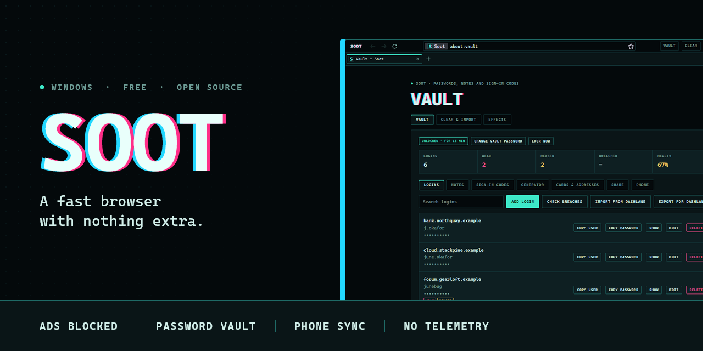
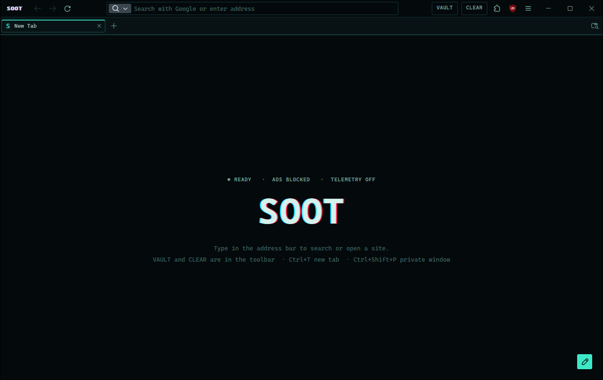
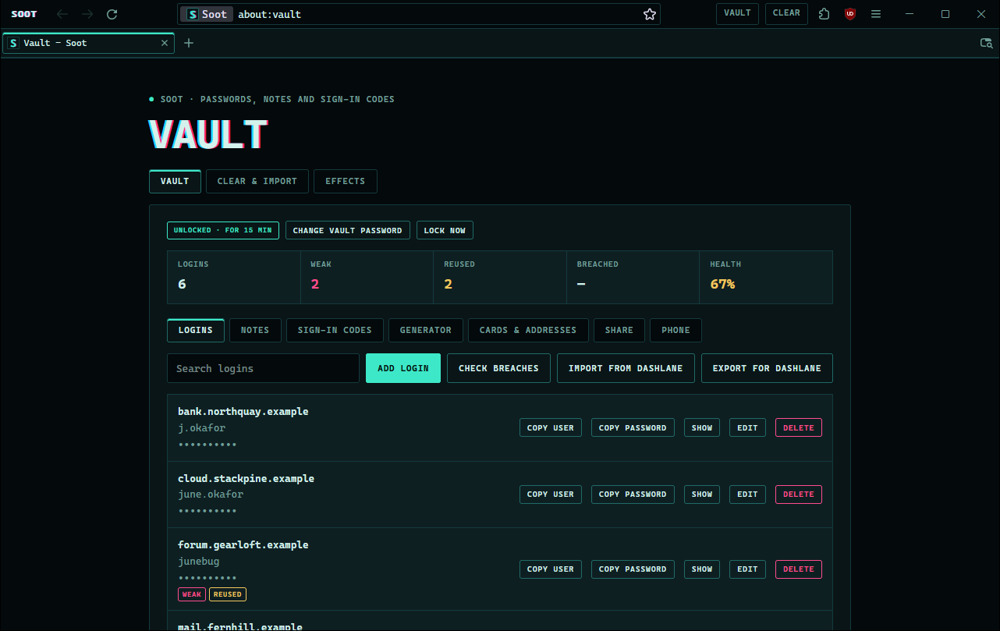
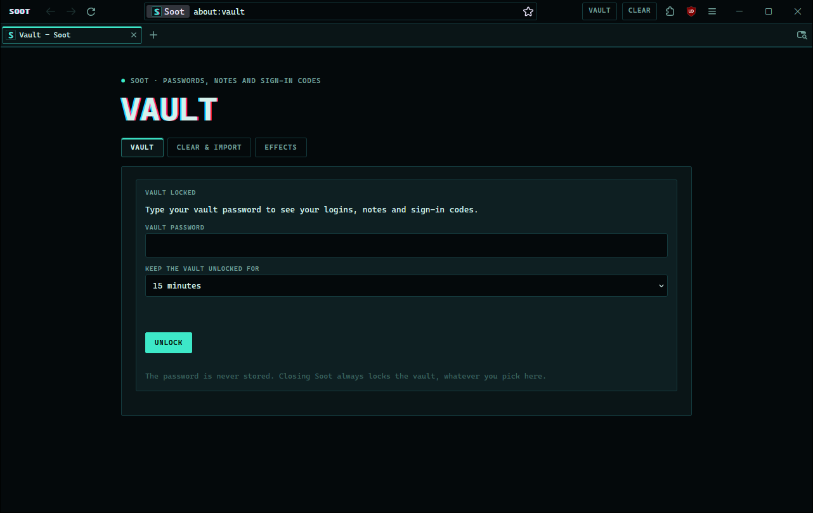
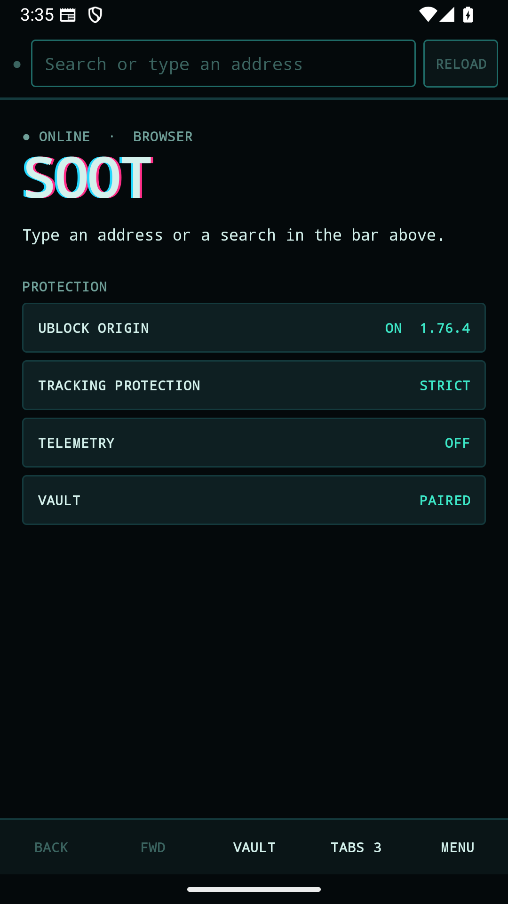
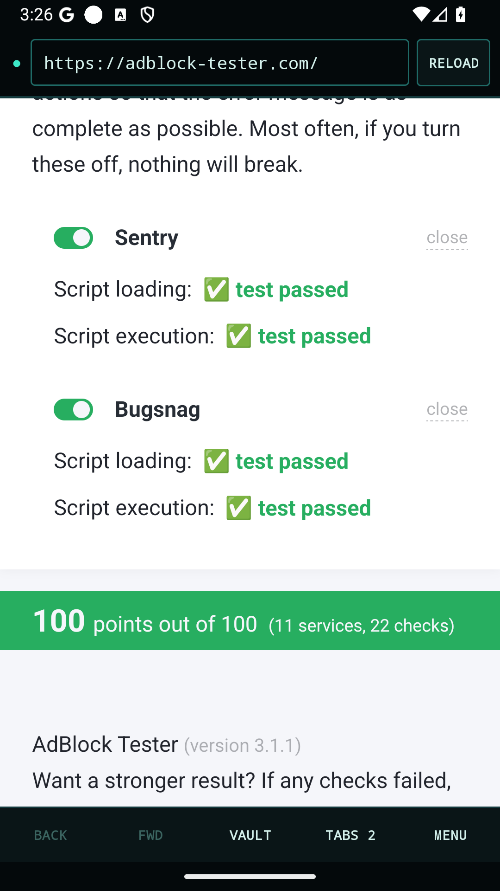
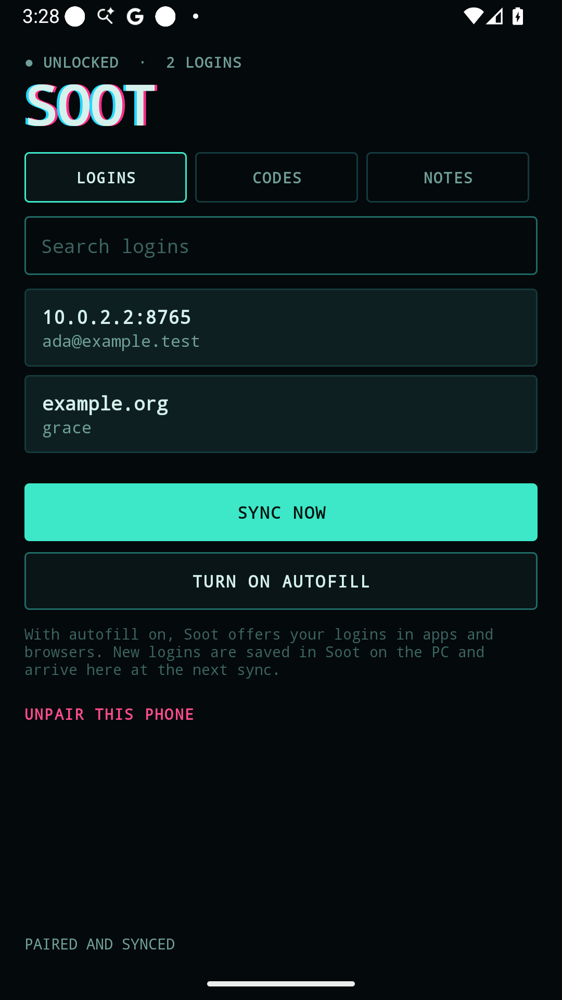
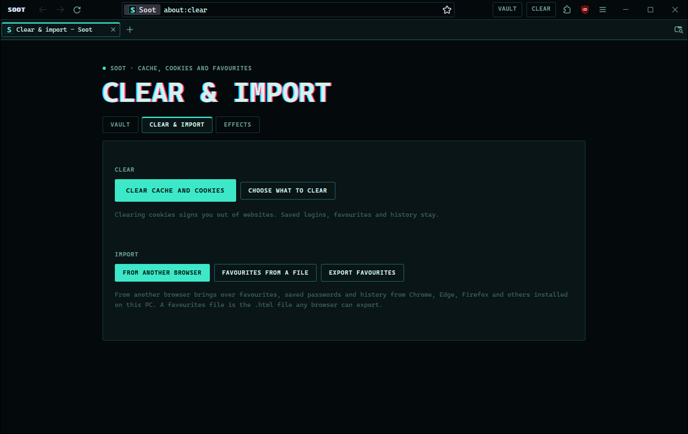
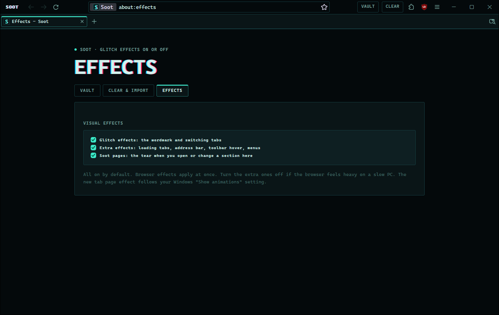
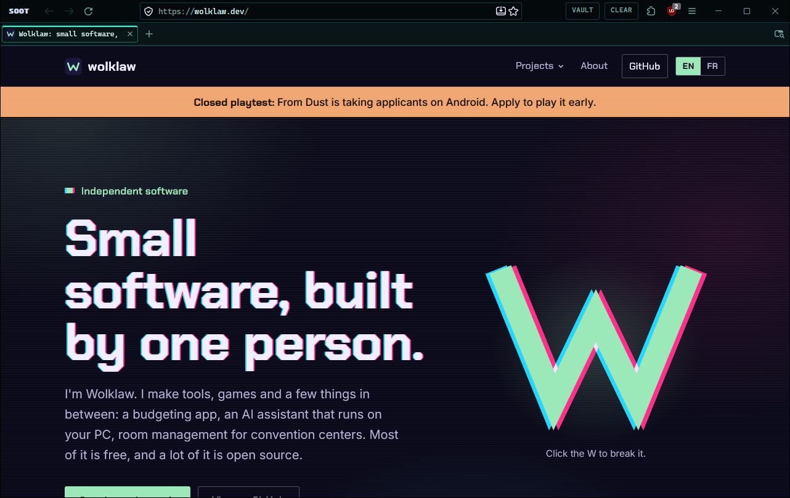

<p align="center">
  
</p>

<p align="center">
  <b>A fast browser for Windows and Linux with nothing extra.</b><br>
  Ads and trackers blocked, a password vault with its own lock, and no telemetry.
</p>

<p align="center">
  <a href="https://github.com/Wolklaw/Soot/releases/latest"></a>
  <a href="https://github.com/Wolklaw/Soot/releases"></a>
  <a href="LICENSE"></a>
  <a href="https://github.com/Wolklaw/Soot/stargazers"></a>
</p>

<p align="center">
  <a href="https://github.com/Wolklaw/Soot/releases/latest"><b>Download Soot</b></a><br>
  Windows 10 or 11 · Linux x86_64 (new, see <a href="#linux">Linux</a>) · free · MIT license
</p>

<p align="center">
  <a href="#why-soot">Why Soot</a> ·
  <a href="#getting-started">Getting started</a> ·
  <a href="#features">Features</a> ·
  <a href="#being-straight-about-it">Limits</a> ·
  <a href="#faq">FAQ</a> ·
  <a href="#building">Build it yourself</a>
</p>

---

Soot is a browser for Windows, with a new Linux port. Pages are drawn by **Gecko, the engine Firefox uses**, so sites work the
way they do in Firefox. Soot is everything around the engine: its own look, a password vault that asks for
its own password, ad and tracker blocking that is on from the first start, and privacy settings chosen so
nothing is sent anywhere you did not ask for.

> No account, no sync service, no sponsored tiles, no "recommended" anything. One folder holds the whole
> browser and your data. Delete the folder and it is gone.

<p align="center"></p>

## Why Soot

Here is what Soot does, and where you can check each point yourself.

| | Soot | Where to check |
|---|---|---|
| Ads and trackers | Blocked from the first start by uBlock Origin and the engine's strict tracking protection | [`config/policies.json`](config/policies.json), [`config/user.js`](config/user.js) |
| Telemetry | Off: usage data, crash reports, studies and experiments | The "nothing sent to Mozilla" and "no background calls home" blocks in [`config/user.js`](config/user.js) |
| Account | None. Soot has no servers | Search the source for web addresses |
| Passwords | A vault that opens only with a password you choose, and locks itself again | [Vault](#vault) |
| Sponsored content | None: no sponsored tiles, suggestions or promos | [`config/user.js`](config/user.js) |
| Search suggestions | Off, so nothing you type is sent before you press Enter. One switch turns them on | Settings, Search |
| Source code | Open, MIT license | [LICENSE](LICENSE) |
| Cost | Free | |

**What Soot's own code contacts:** `download.mozilla.org` once, to fetch the engine, and
`api.pwnedpasswords.com` only when you press CHECK BREACHES in the vault (it sends the first five
characters of a hash, never a password). That is all.

**What the engine still contacts**, because turning these off would make the browser less safe: Mozilla for
engine and add-on updates, and the Safe Browsing lists that warn about malware and phishing pages. uBlock
Origin updates its filter lists from their publishers.

## Getting started

**You need** Windows 10 or 11, 64-bit, and about 500 MB of disk space.

1. Download `Soot-<version>.zip` from the [latest release](https://github.com/Wolklaw/Soot/releases/latest).
2. Unzip it wherever you want Soot to live. There is no installer.
3. Run `Soot.exe`. Windows may warn that the app is from an unknown publisher, because it isn't
   code-signed. Choose **More info**, then **Run anyway**.
4. The first time, Soot asks to download its engine from Mozilla (about 90 MB). It checks that the file is
   signed by Mozilla, unpacks it into the Soot folder, and installs nothing on the PC.
5. Soot opens. A Start menu entry called Soot is created; pin that one to the taskbar.

To bring your things over from another browser, press **CLEAR** in the toolbar, then **FROM ANOTHER
BROWSER**: favourites, saved passwords and history from Chrome, Edge, Firefox and others on the PC.

To remove Soot, delete its folder and the Start menu entry.

### Linux

Linux support is new. Soot comes preinstalled on [SparkOS](https://github.com/Wolklaw/sparkos); on other
x86_64 distributions, install it from the source:

```bash
git clone https://github.com/Wolklaw/Soot && sudo bash Soot/linux/install.sh
```

The script downloads Mozilla's Linux build of the engine, checks it against Mozilla's published SHA-256
list, and puts everything in `/usr/lib/soot`, with a `soot` command in `/usr/bin` and a menu entry.
`--prefix`, `--bindir` and `--datadir` change those places, so it also installs into your home folder
without root (`bash linux/install.sh --help`). It needs `curl`, `tar`, `xz` and the usual desktop
libraries (GTK 3).

What is different on Linux:

- **Your data is in `~/.local/share/soot`**, not next to the program, because `/usr` is read-only on
  image-based systems. Set `SOOT_PROFILE` to use another folder.
- **The engine does not update itself.** Run `install.sh` again to get a new engine; on SparkOS the daily
  image rebuild does it. Add-ons, uBlock filter lists and Safe Browsing lists update as on Windows.
- `soot --private` opens a private window.

What is not there yet, or not proven:

- **It has been tested by an automated headless run only** ([`linux/smoke-test.py`](linux/smoke-test.py),
  run on Fedora for every change): settings, policies, the vault code and Soot's pages load. Nobody has
  yet checked the interface by eye on a Linux desktop, so the title bar buttons and effects may need fixes.
- **Phone sync's firewall step is untested.** With firewalld, Soot asks once (through `pkexec`) for an
  opening on port 47600 from home-network and Tailscale addresses. Other firewalls are yours to open.
- **Importing from another browser** depends on what the engine supports on Linux; fewer browsers than
  on Windows.
- **If `/etc/firefox/policies/policies.json` exists**, the engine reads it instead of Soot's policies.
- System monitors list the process as `firefox`. ARM is not supported. There is no package (rpm, deb,
  Flatpak) yet.

## Features

### Vault

Saved logins with search, a password generator, encrypted notes, two-step sign-in codes, card and address
autofill, and encrypted sharing of a single login.

- **One master password.** The vault uses the same password Soot asks for when it starts: typing it there
  opens the vault too, so you don't type it twice. Without it set, the first vault visit makes you choose
  one (12 characters or more). Each login is encrypted with AES-256, and the key is locked with your
  password, stretched through 600,000 rounds of PBKDF2-SHA256.
- **Keep it unlocked for as long as you choose:** this visit only, 15 minutes, 1 hour, 4 hours, or until
  you close Soot. The same choice applies when you unlock at startup. Closing Soot always locks it. LOCK
  NOW locks it at once.
- **Password health:** weak, reused and old passwords are flagged, and CHECK BREACHES looks each one up in
  known leaks without sending the password.
- **Import from Dashlane, Bitwarden and others:** Dashlane's .zip or .csv files, Bitwarden's .csv, .json
  and password-protected .json (it asks for the file password; exports locked to a Bitwarden account, or
  protected with Argon2id, can't be opened), and any CSV with url, username and password columns.
  Sign-in codes become two-step codes, secure notes, cards and IDs become encrypted notes, and logins
  without a web address are kept as notes so nothing is lost.
- **Duplicates checked:** an account already saved with the same password is skipped. One saved with a
  different password is listed for you to keep or replace. Copies already in the vault get a DUPLICATE
  mark, and REMOVE EXACT COPIES deletes the ones with the same site, username and password.
- **Sorted your way:** by site, username, last used, last changed, or problems first. The choice is kept.
- **Export:** EXPORT CSV writes Dashlane's layout.

There is no recovery. If you forget the master password, the vault cannot be opened.

<p align="center"></p>

<p align="center"></p>

### Phone

Soot for Android is a browser too, built on GeckoView, the same Gecko engine packaged by Mozilla for
Android, and it carries the vault. It is a first version: read the list of what is missing before you
rely on it.

<p align="center">
  
  
  
</p>

What works:

- Address bar (an address, or a search sent to Google like on the PC), tabs, back, forward, reload and stop.
- Private tabs: nothing from them is kept once they are closed, and they stay out of screenshots and the
  recents list.
- uBlock Origin, downloaded from addons.mozilla.org on the first start and on in normal and private tabs.
  The first page waits for it. The first start needs a connection; without one Soot says the blocker is
  not installed and tries again when you tap its row.
- The engine's tracking protection set to strict, cookies kept per site, tracking tags stripped from
  links, Global Privacy Control on, no telemetry and no crash reports. The settings from
  [`config/user.js`](config/user.js) that mean something on Android are in
  [`phone/assets/soot-prefs.yaml`](phone/assets/soot-prefs.yaml) and
  [`Engine.java`](phone/src/dev/wolklaw/soot/Engine.java).
- The vault, one tap away on the bottom bar: an encrypted copy of your logins, notes and sign-in codes.
  On a page with a sign-in form Soot fills the login it has for that site, or asks which one when there
  are several.
- Autofill in other apps, as before.
- Links from other apps can open in Soot. Glitch effects can be switched off in the menu.

What is not there yet: bookmarks and history screens, downloads, file uploads, find in page, the uBlock
Origin dashboard and per-site switch (it runs with its default lists, not the extra lists the PC turns
on), camera, microphone and location for sites (they are refused), reopening your tabs after Android
closes the app, a desktop-site switch, and saving a new login from the phone. Only phones with a 64-bit
ARM processor are covered, which is every phone sold in recent years. It has been run on an Android 16
emulator, not yet on real phones.

`phone\Soot.apk` (also on the release page) is about 100 MB, nearly all of it the engine.

1. On the PC: **VAULT**, then **PHONE**, then **TURN ON PHONE SYNC**. Windows asks once to allow Soot to
   make changes. That adds one firewall opening named "Soot phone sync (anywhere)": this engine, port
   47600, only from your local network and Tailscale addresses (100.64.0.0/10).
2. Copy `Soot.apk` to the phone and open it to install. Android asks you to allow installing from that
   source.
3. In the app, press **VAULT**, type the address the PC shows and press **PAIR**. Both screens show a
   six-digit code. If they match, press **THE CODES MATCH** on the PC.
4. In the vault, press **TURN ON AUTOFILL** and choose Soot, if you want your logins in other apps too.

At home it uses your Wi-Fi. Away from home it works through [Tailscale](https://tailscale.com) (free):
install it on the PC and the phone, sign in to the same account, and type the PC's 100.x address.

How it is protected: pairing is an ECDH key agreement, checked by the code you compare. The vault travels
and is stored as AES-256-GCM ciphertext. On the phone the key sits in the Android Keystore, tied to your
screen lock, so set a PIN or fingerprint. If the phone has not been unlocked in the last five minutes,
the bottom bar says **UNLOCK** before Soot fills a login.

Limits: sync is one way, PC to phone, and only while Soot is running on the PC with the vault unlocked.
Logins you create on the phone are not saved back.

#### Link to PC (Spark Link)

The phone side of Spark Link, SparkOS's own phone link (the PC side is the Spark Link app in SparkOS;
both follow `docs/spark-link-protocol.md` in the SparkOS repository). Open it from **MENU**, **LINK TO
PC**. In Spark Link on the PC choose Pair a phone, then on the phone **SCAN THE CODE**, paste the
pairing link, or type the address and code the PC shows (Soot then shows the PC's key to compare with
the PC screen). Once paired:

- **Links**: **SEND TAB TO PC** in the menu, or Share, **Send to PC** from any app. Links from the PC open
  in Soot (when Soot is in the background they wait in a notification: Android doesn't let an app open
  a screen on its own).
- **Files** both ways: **FILES** on the Link screen or Share, **Send to PC**. Files from the PC go to
  Downloads after you accept them (or always, if you switch that on).
- **Shared clipboard**, off by default. Text copied in Soot goes to the PC; for other apps use **SEND
  CLIPBOARD** in the Link notification, because Android lets an app read the clipboard only while it is
  on screen.
- **Notifications** on the PC, off by default, read-only, after you give Soot Android's notification
  access. **Battery** level on the PC. **Find my phone**: the PC rings the phone on the alarm volume
  until you tap the notification (at most 10 minutes).

Each one has its own switch. **BACKGROUND CONNECTION** off means Soot links only while it is open on
screen; on, it keeps a lasting notification. The phone connects straight to the PC over TLS 1.3, each
side trusts only the other's certificate from pairing, and the phone's key never leaves the Android
Keystore. Nothing goes through an outside server of Soot's or Spark Link's.

**Away from home** it works through [Tailscale](https://tailscale.com), like the vault sync: put the PC and
the phone on the same tailnet. While they're linked at home the PC tells the phone its Tailscale address;
when the home network doesn't answer, the phone tries that address. The Link screen shows it under PC
ADDRESS. This needs the Spark Link update that sends that address. You can also type the PC's 100.x
address there: Soot keeps it as a Tailscale address, tried after the home network, and the PC can't
overwrite it. When the PC can't be reached, the Link screen lists each address tried and why it failed.

It has been tested on an Android 16 emulator against the Spark Link service (run by its own test
harness on Windows) and against a stand-in PC ([`phone/tools/spark_link_pc.py`](phone/tools/spark_link_pc.py)).
It has not been run on a real phone or on SparkOS itself yet. Finding the PC by mDNS, the QR camera,
and notifications to the PC are untested. The Tailscale fallback works on a real phone: on 2026-11-24,
Soot 0.4 on a Pixel 8 Pro reached Spark Link on SparkOS over Tailscale with Wi-Fi off. The typed Tailscale
address and the list of failed tries (0.4.1) are built but not yet run on a phone.

### Clear and import

One button clears cache and cookies. The same page imports favourites, passwords and history from other
browsers, or favourites from an .html file, and exports your favourites.

<p align="center"></p>

### Privacy defaults

Set before the first page loads, all in [`config/user.js`](config/user.js) and
[`config/policies.json`](config/policies.json):

- Trackers, fingerprinters and cryptominers blocked (strict mode), and each site kept in its own cookie jar.
- Fingerprinting protection on, cross-site referrers trimmed, tracking tags stripped from links.
- Cookie banners declined where possible.
- No tracking pings, no ad-measurement reports, no link prefetching.
- Telemetry, crash reports, studies, experiments, sponsored content and the on-device AI features off.

Strict blocking can break the odd site. The shield in the address bar turns protection off for that one site.

### Effects

Soot's look is a glitch: a magenta and a cyan channel slipping out of line. The **EFFECTS** page has three
switches, for the wordmark and tab effects, the heavier effects on loading tabs, menus and the address bar,
and the effects on Soot's own pages. Turn the heavier ones off on a slow PC.

<p align="center"></p>

### Speed

Interface easing and tab hover previews are off, the first frame paints at once, background tabs load only
when you open them, and the session is saved once a minute. Every setting is listed under "speed" in
[`config/user.js`](config/user.js).

<p align="center"></p>

## Being straight about it

- **The engine is Firefox's.** Soot does not have its own rendering engine. It downloads Mozilla's official
  build and changes the name, look and settings around it. Soot is not affiliated with or endorsed by
  Mozilla.
- **Engine and add-on updates still come from Mozilla.** Updates matter for security, so they stay on.
- **Task Manager lists the process as firefox.exe**, and two technical pages (about:support,
  about:policies) still show the engine's name in paths and setting names. The identification string
  websites read is left alone too: changing it breaks sites.
- **It is not code-signed**, so Windows SmartScreen warns the first time.
- **The interface targets engine version 160.** A large engine redesign may need the styles and `app\`
  code adjusted before Soot looks right again.
- **Google is the default search engine.** Change it in Settings, Search.
- `Soot.exe --private` opens a private window.

## FAQ

**Is this a new browser engine?** No. It is Gecko, from Mozilla's own installer, with Soot's interface,
vault and settings on top.

**Do my Firefox add-ons work?** Yes. Add-ons install from addons.mozilla.org as they do in Firefox.

**Does it touch the Firefox I already have?** No. Soot keeps its own engine and its own profile inside its
folder.

**Where is my data?** In the `profile\` folder next to `Soot.exe`: history, cookies, vault, add-ons. Back
that folder up. Delete it to start fresh.

**A site is broken.** Click the shield in the address bar and turn protection off for that site. If it
still fails, try the uBlock Origin button and switch it off for the site.

**I forgot my master password.** There is no recovery. Deleting `profile\` starts a new, empty vault.

**Why does Windows warn me when I run it?** `Soot.exe` is not code-signed. The source of the launcher is
in [`launcher/Soot.cs`](launcher/Soot.cs) and `build.cmd` rebuilds it.

## What is in the folder

| Path | What it is |
| --- | --- |
| `Soot.exe` | Launcher. Starts the engine with Soot's profile and settings. |
| `app\` | Soot's own code and pages that run inside the engine: `boot.sys.mjs` (name, icon, taskbar, buttons, vault lock, phone sync) and `content\hub.*` (vault, clear and import, effects). |
| `config\` | `policies.json`, default settings in `user.js`, the interface in `chrome\`, and the startup hook in `autoconfig\`. |
| `engine\` | The Gecko engine, unpacked from Mozilla's official installer on first run. Separate from any Firefox you have. |
| `profile\` | Your data. Created on first run. |
| `launcher\` | Source of `Soot.exe` and the icon script. |
| `phone\` | The Android app: a browser on GeckoView with the vault. Source, and `Soot.apk` in the release. |
| `setup.cmd` | Downloads the engine again, to repair it or start from a clean one. |
| `linux\` | The Linux port: `install.sh`, the `soot` launcher (what `Soot.exe` is on Windows), the menu entry and the smoke test. |

## Building

You need Windows with the .NET Framework 4 compiler that ships with it.

- `build.cmd` rebuilds `Soot.exe` from `launcher\Soot.cs` and redraws the icons.
- `setup.cmd` downloads the engine into `engine\`.
- `phone\build.ps1` builds the Android app. It needs a JDK (17 or newer) and the Android SDK, and uses
  Gradle through the wrapper in `phone\`: the first run downloads Gradle, the Android build plugin, an SDK
  platform and the engine, about 1 GB, into your Gradle and SDK folders. `-Abi x86_64` builds for an
  emulator. It creates a signing key the first time. Keep that key: updates must be signed with the same
  one.

Everything else is plain JavaScript, CSS and HTML that the engine loads from `app\` and `config\` at start.

## Credits and licenses

Soot's own code is [MIT licensed](LICENSE). The engine is [Mozilla's Gecko](https://www.mozilla.org/firefox/),
under the Mozilla Public License 2.0, downloaded from Mozilla and not redistributed here.
[uBlock Origin](https://github.com/gorhill/uBlock) is by Raymond Hill, GPLv3, installed from
addons.mozilla.org on first start, on the PC and on the phone. The Android app includes Mozilla's
[GeckoView](https://mozilla.github.io/geckoview/) (MPL 2.0) and the libraries it depends on, fetched by the
build, and [ZXing](https://github.com/zxing/zxing) (Apache 2.0) to read the pairing QR code. Firefox is a trademark of the Mozilla Foundation.

Made by [Wolklaw](https://wolklaw.dev). Found a bug or want a feature?
[Open an issue](https://github.com/Wolklaw/Soot/issues).
